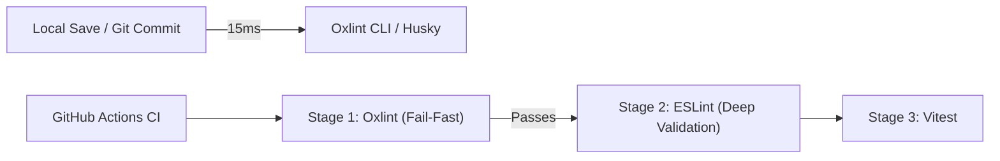

# Linting Strategy: Oxlint + ESLint Hybrid

AdTech Flow adopts a **hybrid linting architecture** combining Oxlint for high-speed local developer feedback and ESLint for deep type-aware and architectural verification.

---

## 1. Why the Hybrid Approach?

- **Oxlint**: Written in Rust. Runs in ~15 milliseconds. It gives instant feedback in the code editor and pre-commit hooks on staged files.
- **ESLint**: Rich ecosystem of plugins. Runs in CI/CD to enforce deep AST rules, React Hooks dependencies, accessibility (`eslint-plugin-jsx-a11y`), and OpenRTB payload constraints.

---

## 2. Pipeline Execution Order



---

## 3. npm Scripts

In `frontend/package.json`:

```json
{
  "scripts": {
    "lint": "npm run lint:fast",
    "lint:fast": "oxlint --deny-warnings",
    "lint:deep": "eslint . --max-warnings 0",
    "lint:fix": "npm run lint:fast:fix && npm run lint:deep:fix"
  }
}
```

`--max-warnings 0` is deliberate: a warning that nobody ever fixes is indistinguishable
from no check at all.

## 3a. Pre-commit Hook

Husky hooks live in `frontend/.husky/` and are registered with:

```bash
git config core.hooksPath frontend/.husky
```

The hook path is `frontend/` rather than the repository root because that is where
`node_modules` and the `lint-staged` config live — the repository root is reserved for
build tooling (the sellers.json ETL).

`lint-staged` runs Oxlint first (fail-fast) and then ESLint on staged `.ts`/`.tsx` files,
both with `--fix`.

---

## 4. Configuration Files

- `frontend/.oxlintrc.json`: TypeScript, React, and hygiene rules for local/pre-commit use.
- `frontend/eslint.config.mjs`: Flat config with `typescript-eslint`,
  `eslint-plugin-react-hooks`, and a `no-restricted-syntax` rule that rejects bare
  `addEventListener('click', …)` in favour of React props with keyboard parity
  (WCAG 2.1 AA, `docs/design-system.md` §4).

Both ignore `dist`, `coverage`, the generated `public/mockServiceWorker.js`, and
`src/mocks`. Vendored shadcn/ui primitives are exempted from `react-refresh`
alone — they co-locate their `cva()` variant map with the component by upstream
convention.

---

## 5. Known Gap

`eslint-plugin-jsx-a11y` is **not** installed. It requires type-aware linting, which is
materially slower than the ~15 ms Oxlint budget this hybrid strategy is built around.

Accessibility is instead enforced through:

1. The `no-restricted-syntax` rule above (static analysis, no type info).
2. Component-level tests asserting accessible names, roles, and keyboard operability
   (see `src/__tests__/App.test.tsx`).
3. A globally mandated `:focus-visible` ring in `src/index.css`.

Re-evaluate if CI runtime becomes a constraint.
